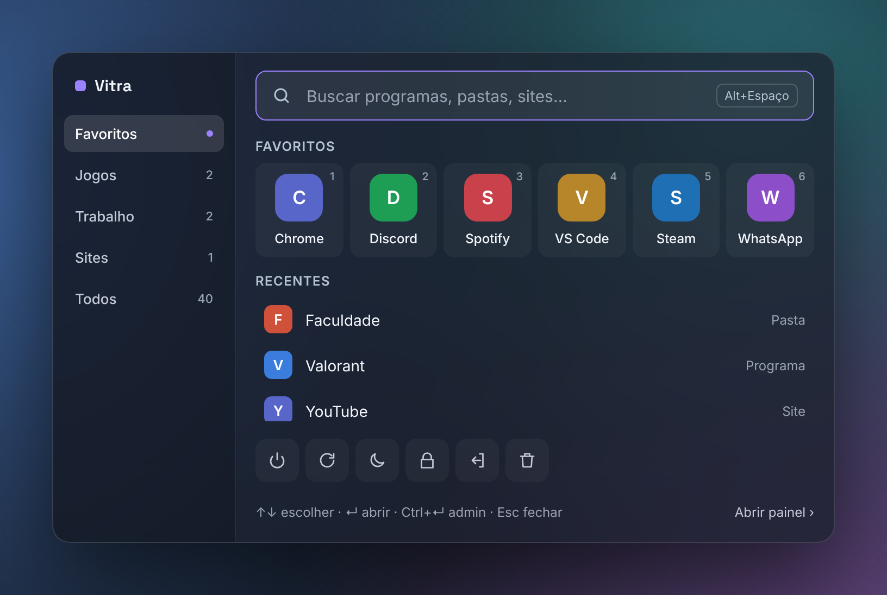
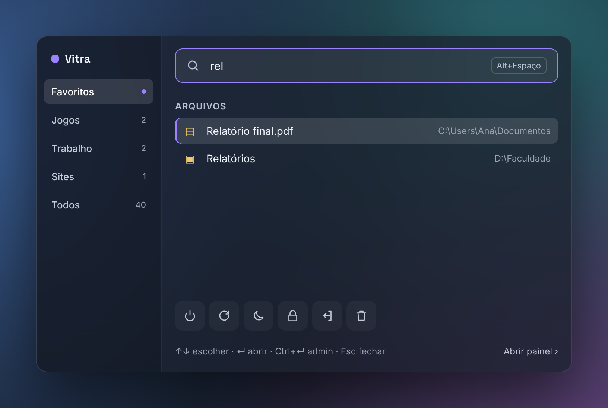
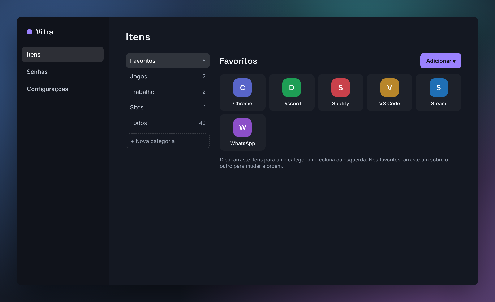
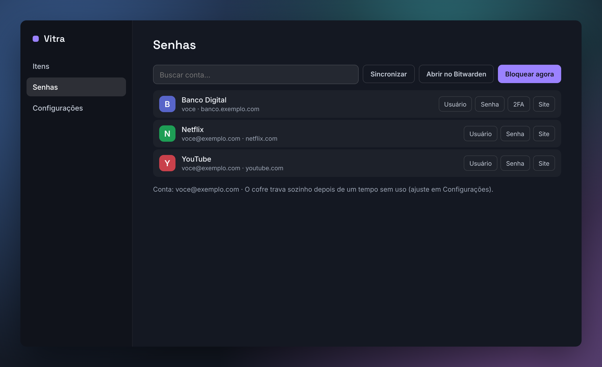

<div align="center">

# Vitra

**Todos os seus programas, pastas, arquivos e senhas num só lugar.**
Aperte <kbd>Alt</kbd> + <kbd>Espaço</kbd>, digite e pronto. A área de trabalho fica limpa.

[**⬇ Baixar para Windows**](https://github.com/Akash03wl/sem-nome/releases/latest) · [Novidades](CHANGELOG.md) · [Reportar um problema](https://github.com/Akash03wl/sem-nome/issues/new/choose)



</div>

## O que o Vitra faz

- **Abre na hora com <kbd>Alt</kbd>+<kbd>Espaço</kbd>.** O pop-up de vidro aparece no centro da tela e some quando você abre algo ou clica fora.
- **Encontra seus programas sozinho.** Ele lista o que está instalado no Menu Iniciar e na Microsoft Store, com os ícones de verdade.
- **Favoritos e categorias.** Monte categorias como Jogos, Trabalho e Sites. Os 6 primeiros favoritos abrem com <kbd>Alt</kbd>+<kbd>1</kbd> … <kbd>6</kbd>.
- **Arraste qualquer coisa para dentro.** Programas, pastas, arquivos e sites vão direto do Windows para o painel.
- **Uma busca para tudo:**
  - programas pelo nome, pelas iniciais (`vsc` → Visual Studio Code) ou com erro de digitação;
  - **qualquer arquivo do PC**, pelo [Everything](https://www.voidtools.com);
  - contas: `250*12` → **3.000**;
  - internet: `yt lofi` abre o YouTube e `g receita de bolo` abre o Google;
  - **senhas** do seu cofre [Bitwarden](https://bitwarden.com).
- **Comandos do PC num clique:** desligar, reiniciar, suspender, bloquear, sair e esvaziar a lixeira. Os perigosos pedem um segundo clique.
- **Modos:** um clique abre vários itens juntos (ex.: "Modo estudo" = navegador + pasta da faculdade + música).
- **Senhas com o Bitwarden:** copie usuário, senha ou código 2FA. A senha some da área de transferência em 30 s, e o cofre trava sozinho.

| Busca de arquivos | Painel | Senhas |
|---|---|---|
|  |  |  |

## Como instalar

1. Baixe o **`Vitra_…_x64-setup.exe`** na [página da última versão](https://github.com/Akash03wl/sem-nome/releases/latest).
2. Abra o arquivo baixado.
   - Se aparecer **"O Windows protegeu o computador"**, clique em **Mais informações → Executar assim mesmo**. Esse aviso aparece porque o Vitra ainda não tem uma assinatura digital (paga). O código é aberto e cada instalador é gerado automaticamente pelo GitHub a partir dele.
3. Pronto. O Vitra fica perto do relógio e abre sozinho quando o Windows liga.

**Requisitos:** Windows 10 ou 11, 64 bits.

### Primeiros passos

1. Aperte <kbd>Alt</kbd>+<kbd>Espaço</kbd>.
2. Em **Todos**, clique com o botão direito num programa → **Adicionar aos favoritos**.
3. Clique em **Abrir painel ›** para criar categorias, adicionar sites e arrastar arquivos.
4. **Busca de arquivos (opcional):** Painel → Configurações → **Instalar Everything**.
5. **Senhas (opcional):** Painel → **Senhas**. Lá você instala a ferramenta do Bitwarden, cria uma conta grátis ou entra na sua.

### Atalhos de teclado

| Tecla | O que faz |
|---|---|
| <kbd>Alt</kbd>+<kbd>Espaço</kbd> | Abre ou fecha o Vitra (dá para trocar em Configurações) |
| <kbd>↑</kbd> <kbd>↓</kbd> e <kbd>Enter</kbd> | Escolhe e abre um resultado |
| <kbd>Ctrl</kbd>+<kbd>Enter</kbd> | Abre como administrador |
| <kbd>Shift</kbd>+<kbd>Enter</kbd> | Abre a pasta do arquivo (numa senha: copia o usuário) |
| <kbd>Alt</kbd>+<kbd>1</kbd> … <kbd>6</kbd> | Abre um dos 6 primeiros favoritos |
| <kbd>Esc</kbd> | Fecha |

## Privacidade e segurança

- **Nada sai do seu PC.** O Vitra não tem conta própria, não tem servidor e não coleta dados (sem telemetria).
- Seus itens e configurações ficam em `%APPDATA%\Vitra`, e os ícones em `%LOCALAPPDATA%\Vitra`.
- **Senhas:**
  - o Vitra nunca grava a senha mestra nem as senhas em disco;
  - a interface nunca recebe a senha: quem copia é o próprio Vitra;
  - senhas copiadas não entram no histórico <kbd>Win</kbd>+<kbd>V</kbd> nem na área de transferência na nuvem.
  - Detalhes em [SECURITY.md](SECURITY.md).

## Perguntas frequentes

**O <kbd>Alt</kbd>+<kbd>Espaço</kbd> não funciona.**
Outro programa (como o PowerToys Run) pode estar usando esse atalho. O Vitra avisa no painel e deixa você escolher outro em **Configurações**.

**Como desinstalo?**
Configurações do Windows → Aplicativos → **Vitra** → Desinstalar.

**Preciso do Everything e do Bitwarden?**
Não, os dois são opcionais. Sem eles, o Vitra continua abrindo seus programas, pastas e sites normalmente.

## Para desenvolvedores

O Vitra é feito com [Tauri 2](https://tauri.app) (Rust) e React + TypeScript.

```bash
npm install
npm test                    # testes da interface (Vitest)
cargo test -p vitra-core    # testes da lógica (Rust, qualquer sistema)
npm run tauri dev           # abre o app em modo desenvolvimento (Windows)
```

- `crates/vitra-core/`: lógica pura em Rust (configurações, biblioteca, busca, regras do cofre), testável em qualquer sistema.
- `src-tauri/`: o app (janelas, bandeja, atalho global, integração com o Windows, Everything e Bitwarden).
- `src/`: a interface.
- `docs/superpowers/`: o documento do projeto e os planos de cada fase; `docs/checklist-de-testes.md`: o que conferir à mão.

A busca de arquivos em modo desenvolvimento precisa do `Everything64.dll` do [SDK do Everything](https://www.voidtools.com/support/everything/sdk/) em `src-tauri/resources/`. Sem ele, o projeto compila normalmente, mas a busca de arquivos fica indisponível.

**Testes no Windows de verdade:** a cada envio, o GitHub instala e abre o Vitra num Windows e roda testes de integração com os apps instalados, os ícones, o Everything e o Bitwarden (veja `.github/workflows/build.yml`).

**Publicar uma versão:** atualize a versão em `src-tauri/tauri.conf.json` e no `CHANGELOG.md`, depois rode `git tag vX.Y.Z && git push origin vX.Y.Z`. O GitHub gera o instalador e publica em Releases.

## Licença

[MIT](LICENSE). Componentes de terceiros: [THIRD-PARTY-NOTICES.md](THIRD-PARTY-NOTICES.md).
